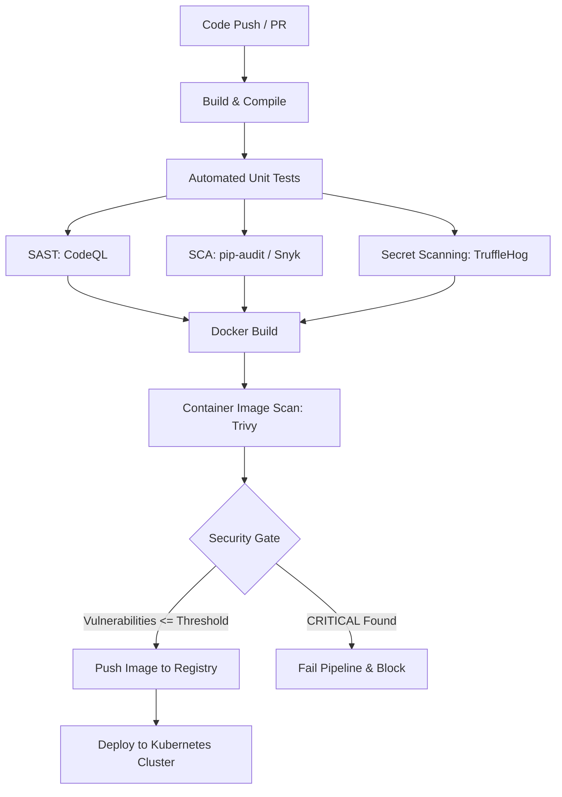

# Session 17: Complete CI/CD & DevSecOps

DevSecOps integrates security practices into the DevOps software development lifecycle. Rather than treating security as an afterthought or a final bottleneck, security checks are automated and "shifted left" directly into CI/CD pipelines.

---

## 🛡️ DevSecOps Architecture Flow

---

## 📂 Topics Covered

| Folder | Topic | Description |
|--------|-------|-------------|
| `02-container-registry/` | Container Registry | Pushing and managing images in Docker Hub / GHCR |
| `03-kubernetes-deployment/` | Kubernetes Deployment | Continuous deployment of updated containers to K8s |
| `04-sast/` | SAST (Static Analysis) | Scanning source code vulnerabilities using GitHub CodeQL |
| `05-sca/` | SCA (Dependency Scan) | Scanning third-party dependencies for known CVEs using pip-audit |
| `06-secret-scanning/` | Secret Scanning | Detecting leaked API keys, tokens, and credentials via TruffleHog |
| `07-container-image-scanning/` | Container Scanning | Scanning container layers and base images with Trivy |
| `08-security-gates/` | Security Gates | Defining automated pass/fail policies before deployment |
| `demo/` | Practice Demo | Reference DevSecOps project implementation |
| `homework/` | **Homework Project** | Full CI/CD + DevSecOps Pipeline & Kubernetes deployment |

---

## 🎯 Homework Deliverables

The complete homework assignment for Session 17 is located in:
👉 [**Session 17 Homework Directory**](./homework/README.md)

### Included Components:
1. **Application Source Code**: Python web application in `homework/app/`
2. **Containerization**: Optimized `homework/Dockerfile`
3. **CI/CD Workflow**: `homework/.github/workflows/devsecops.yml`
4. **Security Tool Integration**:
   - **SAST**: GitHub CodeQL analysis
   - **SCA**: `pip-audit` dependency vulnerability scanner
   - **Secret Scanning**: `trufflehog` scanning commit history
   - **Container Scanning**: Aqua Security `trivy-action`
   - **Security Gate**: Automated threshold checking for Critical CVEs
5. **Kubernetes Manifests**: `homework/k8s/deployment.yaml` and `homework/k8s/service.yaml`
6. **Documentation**: `homework/README.md` and `homework/SECURITY.md`
