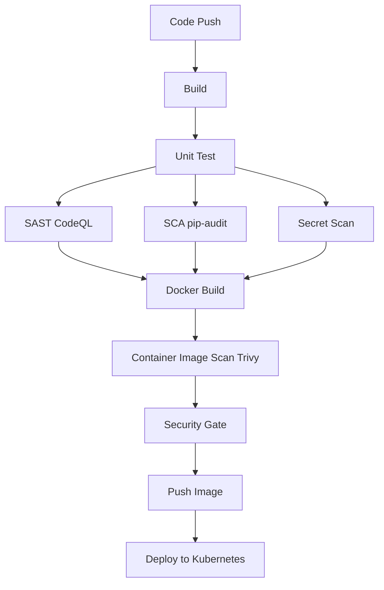

# Session 17: Complete CI/CD & DevSecOps Pipeline

## 1. Overview
This project demonstrates a complete DevSecOps pipeline built with GitHub Actions. It integrates security at every stage of the software development lifecycle, from code analysis to container scanning and secure deployment to Kubernetes.

### Architecture Flow

## 2. DevSecOps Tools Configured
- **Unit Testing**: Pytest
- **SAST (Static Application Security Testing)**: GitHub CodeQL
- **SCA (Software Composition Analysis)**: pip-audit
- **Secret Scanning**: TruffleHog (via trufflesecurity/trufflehog action)
- **Container Image Scanning**: Trivy
- **Security Gate**: Custom bash evaluation (checks Trivy results for `CRITICAL` vulnerabilities)

## 3. Kubernetes Deployment
The pipeline builds the Docker image, pushes it to Docker Hub, and automatically updates the Kubernetes deployment manifest `k8s/deployment.yaml` with the latest commit SHA. Finally, it deploys the updated manifests to the cluster.

## 4. How to Run
1. Fork or clone this repository.
2. Add your Docker Hub credentials as GitHub Secrets:
   - `DOCKERHUB_USERNAME`
   - `DOCKERHUB_TOKEN`
3. Push to the `main` branch to trigger the full pipeline.

## 5. Successful Pipeline Output

*(Please add your screenshots of the successful GitHub Actions pipeline execution here)*

## 6. Deliverables Included
- **Application source code**: (`app/`)
- **Dockerfile**: Defines the container image.
- **GitHub Actions workflow**: (`.github/workflows/devsecops.yml`)
- **Kubernetes manifests**: (`k8s/deployment.yaml`, `k8s/service.yaml`)
- **Security Tools configuration**: Integrated directly within the workflow file.