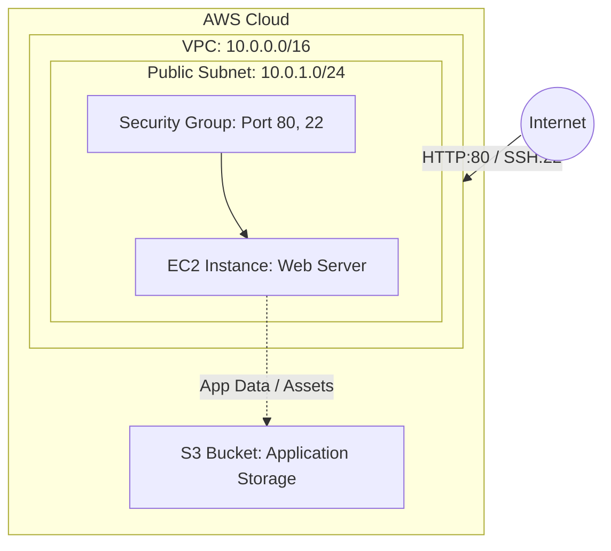

# Session 19 Homework: Cloud & Terraform in Action

## End-to-End Cloud Infrastructure with Terraform

This homework project demonstrates an end-to-end cloud infrastructure deployment on AWS using Terraform.

The implementation is located in:
👉 [**end-to-end-aws-infra Directory**](./end-to-end-aws-infra/README.md)

---

## 🏛️ Architecture Overview



---

## 📦 Resources Provisioned

1. **Virtual Private Cloud (VPC)**: Isolated network space with `10.0.0.0/16` CIDR.
2. **Public Subnet**: `10.0.1.0/24` subnet mapped to automatically assign public IPs.
3. **Internet Gateway & Route Table**: Routes outbound and inbound traffic to the internet.
4. **Security Group**: Restricts ingress to HTTP (port 80) and SSH (port 22) and allows all egress.
5. **EC2 Instance**: Virtual machine configured with `user_data` to bootstrap an Apache web server.
6. **S3 Bucket**: Scalable cloud object storage with dynamic naming.

---

## 📂 Project Structure

```text
homework/
└── end-to-end-aws-infra/
    ├── provider.tf          # AWS provider configuration
    ├── variables.tf         # Input variables (region, CIDR blocks, instance type)
    ├── terraform.tfvars     # Variable values for deployment
    ├── main.tf              # VPC, Subnet, IGW, Route Table, SG, EC2, S3
    ├── outputs.tf           # EC2 Public IP, S3 Bucket name, VPC ID
    └── README.md            # Execution instructions and architecture details
```

---

## 🚀 Execution Commands

```bash
cd end-to-end-aws-infra

# 1. Initialize provider plugins
terraform init

# 2. Check formatting and validation
terraform fmt
terraform validate

# 3. Preview execution plan
terraform plan

# 4. Deploy resources
terraform apply -auto-approve

# 5. Review outputs
terraform output

# 6. Teardown resources
terraform destroy -auto-approve
```
