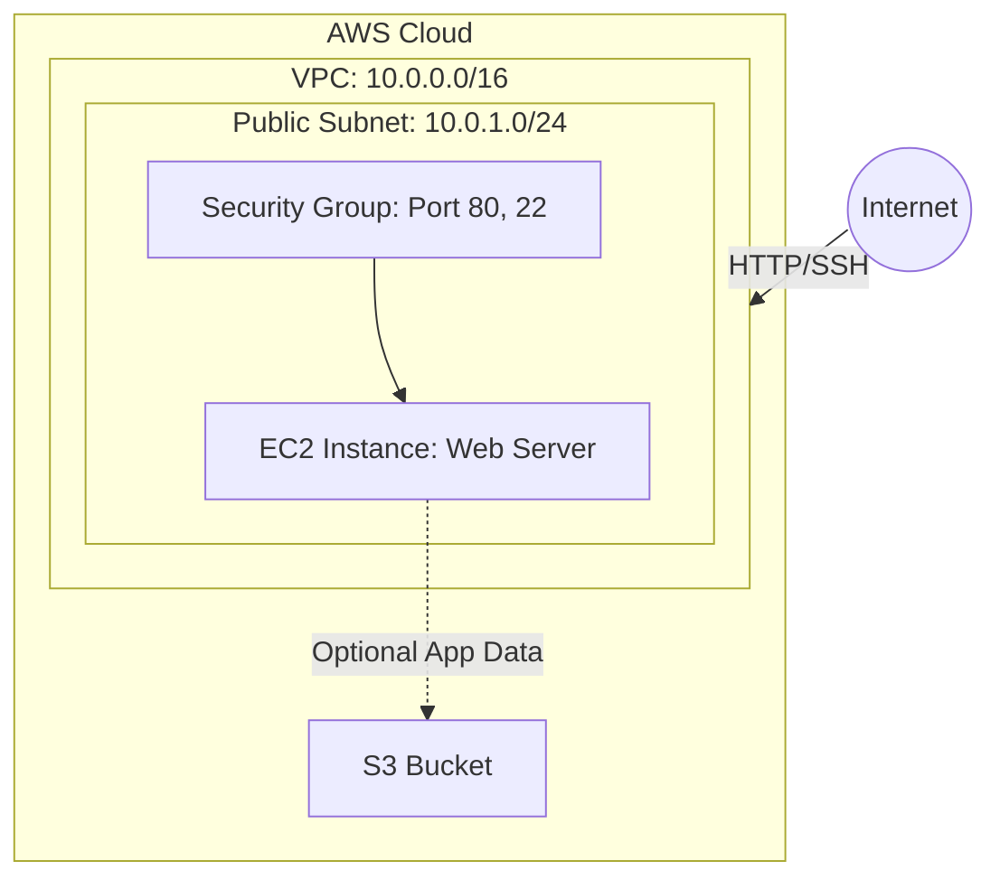

# End-to-End Cloud Infrastructure with Terraform

## 1. Overview
This project provisions a complete, end-to-end cloud infrastructure on AWS using Terraform. It sets up networking, security, compute, and storage resources with defined dependencies.

## 2. Architecture Diagram



## 3. Provisioned Resources
1. **AWS VPC**: A virtual private cloud providing network isolation.
2. **AWS Subnet**: A public subnet within the VPC.
3. **AWS Security Group**: A firewall acting at the instance level, allowing HTTP (80) and SSH (22) access.
4. **AWS EC2 Instance**: A virtual server deployed in the subnet, running a basic Apache web server via `user_data`. It implicitly depends on the Subnet and Security Group.
5. **AWS S3 Bucket**: An object storage bucket with a dynamically generated unique name.

## 4. Deliverables
- `main.tf`: Contains all the AWS resources.
- `variables.tf`: Contains all variables.
- `terraform.tfvars`: Contains the actual variable values used.
- `outputs.tf`: Outputs important IDs and the EC2 Public IP.
- `provider.tf`: AWS provider configuration.

## 5. Terraform Commands to Execute
To deploy this infrastructure, follow these steps:

1. **Initialize Terraform:**
   Downloads the necessary provider plugins (AWS) and initializes the state backend.
   ```bash
   terraform init
   ```

2. **Format and Validate:**
   Ensures the code is correctly formatted and syntactically valid.
   ```bash
   terraform fmt
   terraform validate
   ```

3. **Plan the Deployment:**
   Shows the execution plan of resources Terraform intends to create.
   ```bash
   terraform plan
   ```

4. **Apply the Infrastructure:**
   Provisions the AWS resources. Type `yes` when prompted.
   ```bash
   terraform apply
   ```

5. **View Terraform State:**
   Inspect the current state of your infrastructure.
   ```bash
   terraform show
   ```

6. **Destroy the Infrastructure:**
   Tears down all the created resources to prevent unexpected billing. Type `yes` when prompted.
   ```bash
   terraform destroy
   ```
