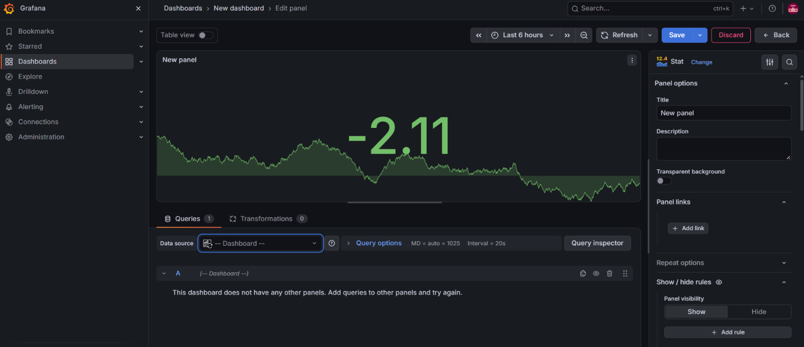

# Session 20: Monitoring, Observability & GitOps

This repository contains deliverables for the tasks assigned in Session 20.

## Directory Structure

### 1. `01-monitoring/`
Contains a complete Monitoring Demo using **Docker Compose**.
It spins up:
- **Prometheus** (for gathering metrics)
- **Node Exporter** (for exposing hardware and OS metrics like CPU and Memory)
- **Grafana** (for visualizing metrics and creating alerts)

*To run the demo:*
```bash
cd 01-monitoring
docker-compose up -d
```
You can access Grafana at `http://localhost:3000` (default credentials: admin/admin) and configure Prometheus as a data source to build dashboards for CPU and Memory utilization.

### 2. `02-observability/`
Contains documentation detailing the **Three Pillars of Observability** (Metrics, Logs, and Traces), why observability is required over traditional monitoring, and common tools used in Kubernetes.

### 3. `03-gitops/`
Contains a comprehensive guide on **GitOps**, explaining declarative configuration, continuous reconciliation, and the workflow. It also includes a demo ArgoCD Application manifest.

## Screenshots

