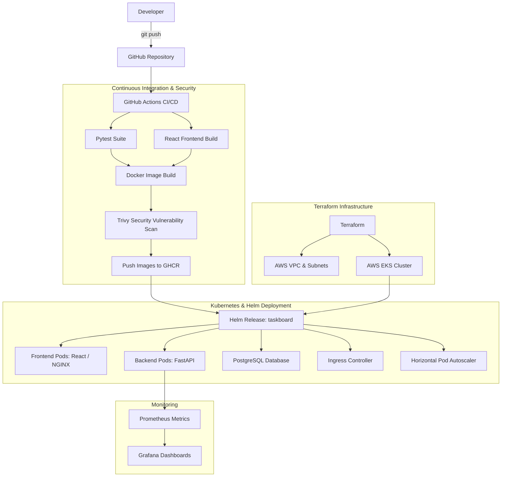

# Session 21 Homework: Final DevOps Capstone Project & Troubleshooting

This document maps the **TaskBoard Python SaaS** application to all requirements specified in **Session 21 (Final DevOps Project & Troubleshooting)** of the course syllabus and homework guidelines.

The full project root is located at:
👉 [**Session 21 Project Root (`session21-python/`)**](../README.md)  
👉 [**Grading Rubric (`GRADING.md`)**](../GRADING.md)

---

## 🏗️ Architecture & Pipeline Flow



---

## 📋 Deliverables Matrix (Mapped to Homework PDF)

| Requirement | Implementation Location | Description |
|-------------|-------------------------|-------------|
| **1. Application** | [`backend/`](../backend/) & [`frontend/`](../frontend/) | FastAPI REST API with PostgreSQL ORM (SQLAlchemy, Alembic migrations) + React Vite frontend UI |
| **2. Testing & Quality** | [`backend/tests/`](../backend/tests/) | Automated tests with `pytest` covering health, root, and task CRUD endpoints |
| **3. Containerization** | [`backend/Dockerfile`](../backend/Dockerfile), [`frontend/Dockerfile`](../frontend/Dockerfile), [`docker-compose.yml`](../docker-compose.yml) | Multi-container stack runnable locally with `docker compose up --build` |
| **4. CI/CD Pipeline** | [`.github/workflows/ci-cd.yml`](../.github/workflows/ci-cd.yml) | Automated workflow: linting, pytest, frontend build, Docker build, and GHCR publishing |
| **5. DevSecOps** | [`.github/workflows/ci-cd.yml`](../.github/workflows/ci-cd.yml) | Aqua Security **Trivy** scanning image layers for `HIGH` and `CRITICAL` CVEs before pushing |
| **6. Terraform IaC** | [`terraform/`](../terraform/) | Provisions AWS VPC, subnets, and Amazon EKS cluster with modular versions and variables |
| **7. Helm & Kubernetes** | [`helm/taskboard/`](../helm/taskboard/) & [`k8s/`](../k8s/) | Helm chart with deployment, service, ingress, HPA, PostgreSQL, probes, and ConfigMaps |
| **8. Monitoring** | [`monitoring/`](../monitoring/) | Prometheus and Grafana values configuration; FastAPI `/metrics` instrumentation |
| **9. Troubleshooting Scenarios** | [`troubleshooting/`](../troubleshooting/) | Pre-configured error scenarios: `broken-image.yaml` (ImagePullBackOff) and `broken-service.yaml` (selector mismatch) |
| **10. Evaluation Rubric** | [`GRADING.md`](../GRADING.md) | Comprehensive 10-module rubric (100 total points) |

---

## 🚀 Quick Start (Local Verification)

```bash
# 1. Run full stack via Docker Compose
cd session21-python
docker compose up --build -d

# 2. Access Web Application
# Frontend: http://localhost:3000
# Backend API Docs: http://localhost:8000/docs
# Health Check: http://localhost:8000/health
# Metrics: http://localhost:8000/metrics

# 3. Run Backend Pytest Suite
cd backend
python -m pytest -v

# 4. Teardown
docker compose down -v
```
